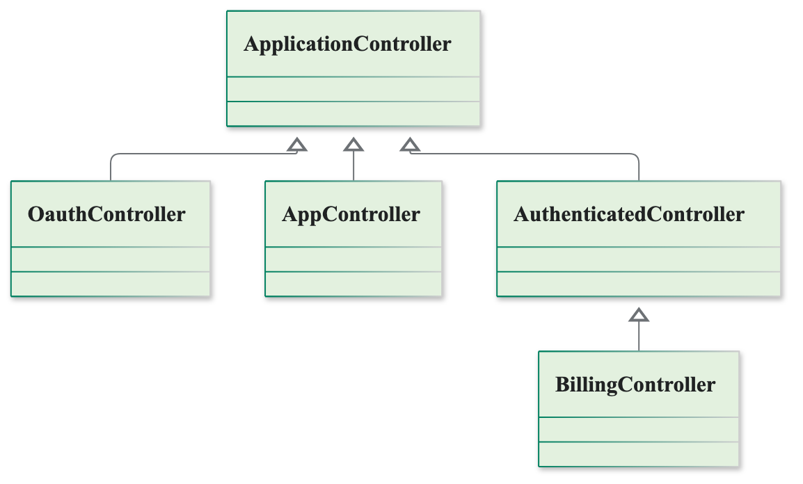
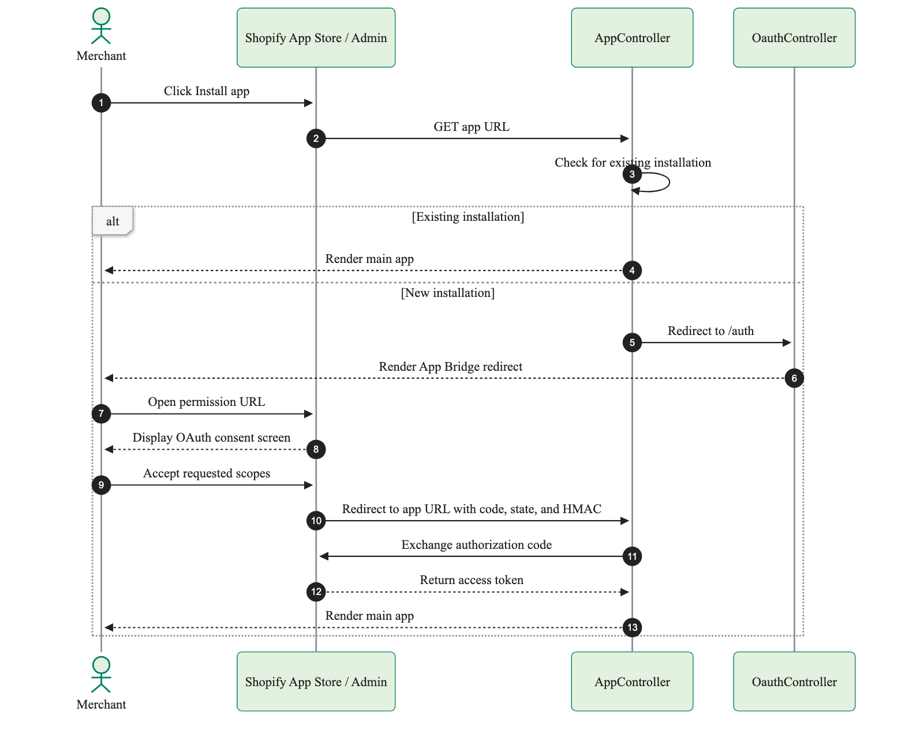

# Overview
This demo is currently in MVP. All documentation is draft.

Includes examples on how to implement the OAuth flow, Session Token authentication, and how to use the Billing API to implement your business model. This app uses the [Ruby Shopify API Gem](https://github.com/shopify/shopify_api) to wrap API calls

This codebase is meant as a guide and is not suited for production! Elements such as error handling, UI design, and various optimizations have been left out in order to maximize emphasis on the three areas of focus.

# Class Structure

[Mermaid source](docs/diagrams/controller-class-structure.mmd)

# OAuth Flow

[Mermaid source](docs/diagrams/oauth-installation-flow.mmd)

